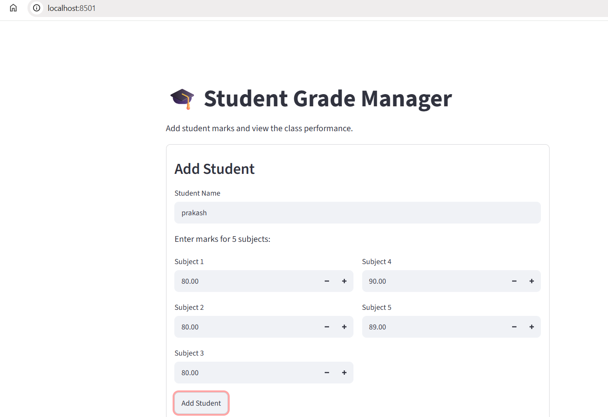
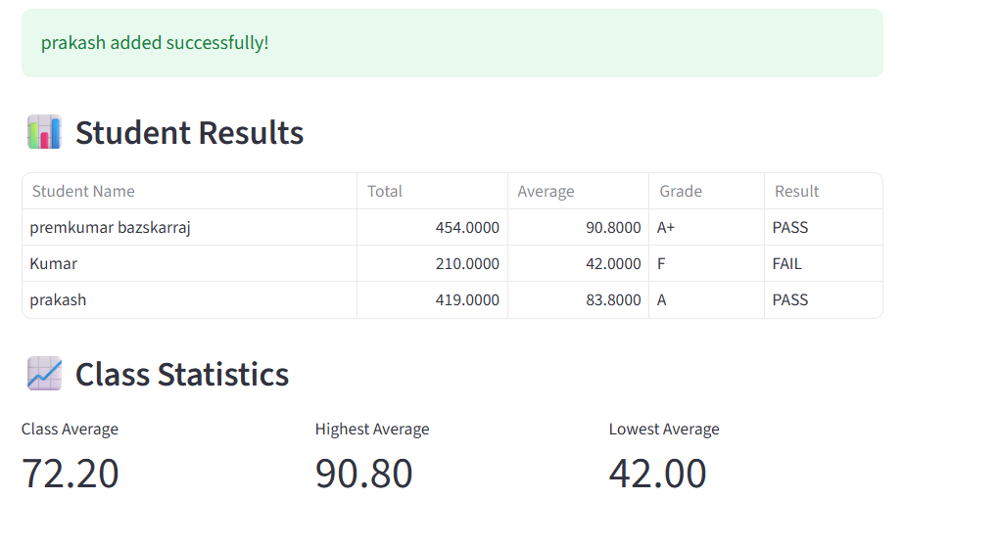

# FastAPI and Streamlit Student Grade App

Two small web apps: a FastAPI service with a couple of endpoints, and a Streamlit app for managing student marks and grades.

> Part of my Gen AI course practice work (Week 1, Day 4).

## Tech stack

- Python 3
- FastAPI + Uvicorn
- Streamlit

## Features

- `FastAPI/` - `GET /` welcome message and `GET /greet/{name}`, with interactive docs at `/docs`
- `Streamlit/` - add students, compute average and grade (A+ 90, A 80, B 70, C 60, D 50, otherwise F), kept in session state

## Getting started

1. Clone the repository:
   ```bash
   git clone https://github.com/Prembazskar/fastapi-streamlit-student-grade-app.git
   cd fastapi-streamlit-student-grade-app
   ```
2. Install and configure:
   ```bash
   pip install -r requirements.txt
   ```

## Usage

```bash
cd FastAPI && uvicorn main:app --reload      # http://127.0.0.1:8000/docs
cd Streamlit && streamlit run grade-system.py
```

## Screenshots






## License

MIT, see [LICENSE](LICENSE).
